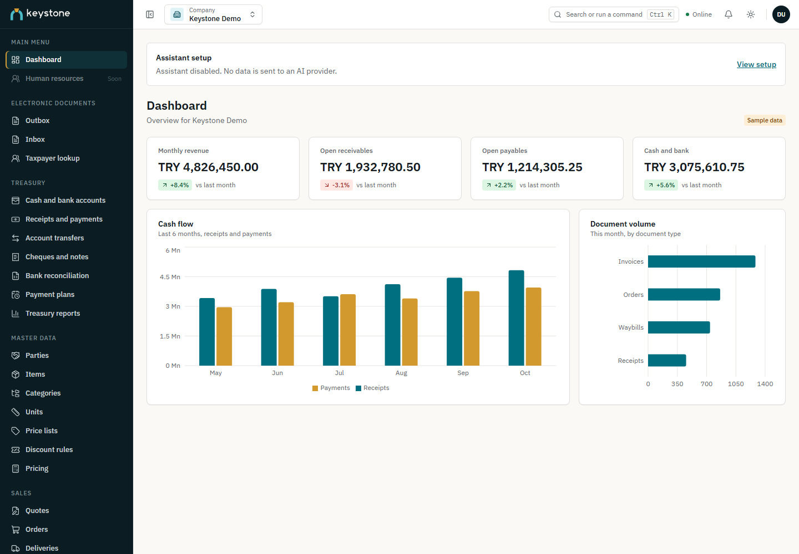
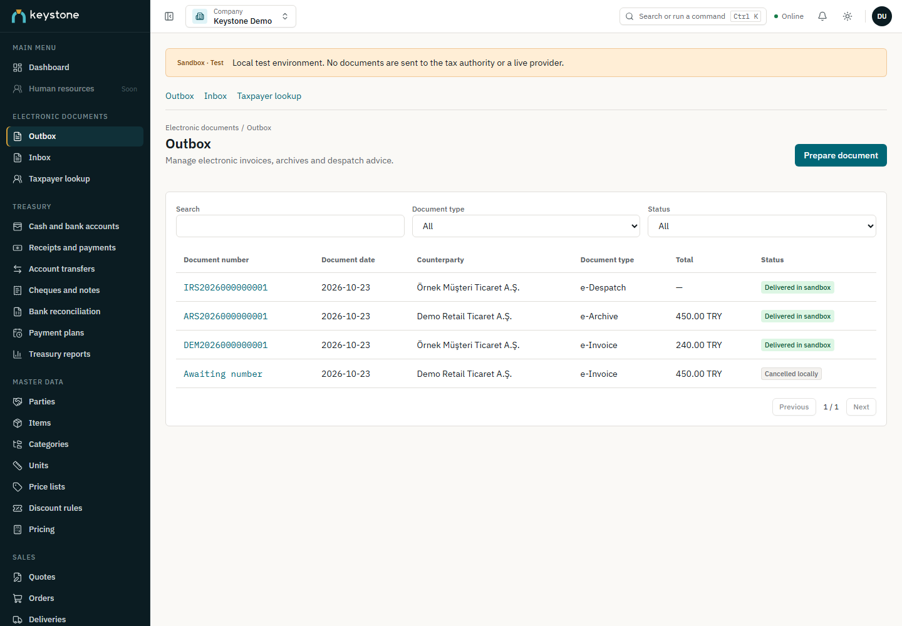
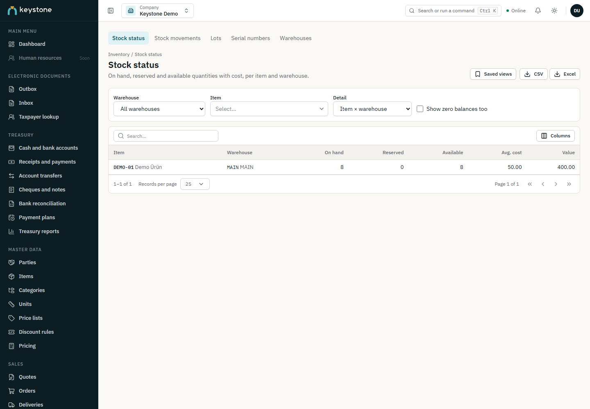

# Keystone ERP

[English](README.md) · [Türkçe](README.tr.md)

Keystone ERP brings accounting, inventory, sales, purchasing and treasury into a company-scoped workspace. It is a modular monolith with a Laravel API and a React web client, with interfaces in English, Turkish, German and French.

Development has reached Phase 9: e-documents with official UBL-TR structural validation and a local sandbox. Manufacturing, HR/payroll and later roadmap modules are not implemented yet. See the [roadmap](docs/ROADMAP.md) and [delivery progress](docs/PROGRESS.md).

## Screenshots

The following screens use synthetic demonstration data.


*Workspace overview.*


*E-document workspace. Statuses and directory results belong to the local sandbox; they are not live GİB results.*


*Inventory and warehouse operations.*

## Implemented scope

| Phase | Area | Capabilities |
|---|---|---|
| 0 | Foundation | Monorepo, development infrastructure, engineering rules and CI checks |
| 1 | Platform | Identity, companies, roles and permissions, files, notifications and approvals |
| 2 | Master data | Parties, items/services, currencies, taxes, payment terms and warehouses |
| 3 | Accounting | Chart of accounts, fiscal periods, journals, financial reports and closing |
| 4 | Inventory | Movements, valuation, transfers, counts, reservations, lots and serials |
| 5 | Sales | Quotes, orders, deliveries, invoices and returns with stock/accounting integration |
| 6 | Purchasing | Requests, RFQs, orders, receipts, invoices, returns and matching |
| 7 | Treasury | Cash/bank, collections/payments, settlements, transfers, cheques/notes and reconciliation |
| 8 | Assistant | Optional company-scoped conversations, permission-aware tools and approved drafts |
| 9 | E-documents | UBL-TR e-invoice, e-archive invoice and e-despatch validation; sandbox outbox/inbox |

Company boundaries, action permissions, optimistic version checks and idempotent requests protect business operations. Accounting and inventory use append-only ledgers and explicit reversal flows. Read the [architecture](docs/ARCHITECTURE.md) and [engineering rules](docs/ENGINEERING-RULES.md) for the constraints behind these workflows.

## Technology

| Layer | Stack |
|---|---|
| Backend | PHP 8.4, Laravel 13, PostgreSQL 18, Redis 8 |
| Frontend | React 19, TypeScript, Vite; Node.js 22.22+ and npm |
| Background/realtime | Redis queues, Laravel Horizon and Reverb |
| Local services | Docker Compose, Mailpit and MinIO |
| E-document validation | PHP DOM/libxml, JDK 21, pinned Saxon runtime |

## Local setup

Install PHP 8.4 with the required Composer extensions, Composer, Node.js 22.22+, Docker Compose and JDK 21. Ensure the intended PHP and Java versions are on `PATH`.

From the repository root:

```sh
docker compose up -d
composer --working-dir=backend install
npm ci
```

On Windows, use `composer --working-dir=backend install-windows` instead of `install`; this handles Horizon's unavailable `pcntl`/`posix` extensions.

Copy `backend/.env.example` to `backend/.env`. Review the local service settings, then add your own first administrator credentials:

```dotenv
ADMIN_NAME=Your Name
ADMIN_EMAIL=your-address@example.com
ADMIN_PASSWORD=replace-with-your-own-long-password
```

There are no default login credentials. Use a password of at least 12 characters that does not equal your name or email. Seeding requires valid credentials and leaves an existing administrator account unchanged.

Initialize the application:

```sh
cd backend
php artisan key:generate
php artisan migrate --seed
php scripts/install-edocument-runtime.php
php scripts/install-edocument-runtime.php --verify-only
cd ..
npm run gen:api
```

The runtime installer downloads checksum-pinned validation dependencies explicitly. Document validation runs offline afterward; a missing runtime fails validation rather than skipping it.

On Windows, run `dev.bat` to start infrastructure and open API, queue, scheduler, Reverb and frontend processes. On other platforms, run these in separate terminals:

```sh
# API, queue listener and Reverb
composer --working-dir=backend dev

# Scheduler
cd backend
php artisan schedule:work

# Frontend, from the repository root
npm run dev --workspace frontend
```

| Service | Local address |
|---|---|
| Web client | http://localhost:5173 |
| API | http://localhost:8000/api/v1 |
| Reverb | http://localhost:8080 |
| PostgreSQL | localhost:5433 |
| Redis | localhost:6379 |
| Mailpit | http://localhost:8025 (SMTP: 1025) |
| MinIO | http://localhost:9001 (API: 9000) |

Compose starts infrastructure services, not the application. PostgreSQL's initial setup creates `keystone` and `keystone_test` and enables `pg_trgm` and `pgcrypto`. Company reference defaults are provisioned when a company is created.

## E-document boundaries

`EDOCUMENTS_DRIVER=sandbox` provides local outbox, inbox, directory and response workflows. Supported documents include basic/commercial/export/public e-invoices, e-archive invoices and basic e-despatches. XML preserves the source document's amounts and is checked against the bundled XSD and Schematron rules.

These are unsigned sandbox documents. Structural validation does not verify a digital signature or establish legal validity. There is no live GİB/private-integrator adapter, legal signing flow or e-archive reporting-package submission. Incoming documents do not automatically create accounting entries or payments. See [e-documents](docs/EDOCUMENTS.md) for setup, permissions and supported operations.

## Optional assistant

The assistant is disabled by default. To enable it, configure the provider's API key on the server and set:

```dotenv
ASSISTANT_ENABLED=true
ASSISTANT_PROVIDER=openai
ASSISTANT_MODEL=your-provider-model
```

The selected model must support tools. Conversations belong to the current user and company. Twenty permission-aware tools provide read access and three human-approved draft types: journal entry, purchase request and sales quote. The assistant cannot post transactions, make payments or delete records. Budget and privacy controls are documented in [Assistant](docs/ASSISTANT.md).

## Validation and API types

```sh
composer --working-dir=backend lint
composer --working-dir=backend analyse
composer --working-dir=backend test
npm run lint --workspace frontend
npm run typecheck --workspace frontend
npm run test --workspace frontend
npm run i18n:check --workspace frontend
npm run build --workspace frontend
```

Backend feature tests need the test database and local dependencies. The e-document tests also need the installed Java validation runtime. The backend test script runs architecture and application suites separately.

OpenAPI output and frontend API types are generated artifacts and are not committed. Run `npm run gen:api` after dependency installation and after API changes, before frontend type checking or builds. API successes use a `data` envelope; errors use an `errors` envelope.

## Documentation

- [Architecture](docs/ARCHITECTURE.md) · [Engineering rules](docs/ENGINEERING-RULES.md) · [Architecture decisions](docs/adr/)
- [Roadmap](docs/ROADMAP.md) · [Progress](docs/PROGRESS.md)
- [Authentication](docs/AUTH-FLOWS.md) · [Multiple companies](docs/MULTI-COMPANY.md) · [Master data](docs/MASTER-DATA.md)
- [Accounting](docs/ACCOUNTING-ENGINE.md) · [Inventory](docs/INVENTORY-ENGINE.md) · [Sales](docs/SALES-ENGINE.md)
- [Purchasing](docs/PURCHASING-ENGINE.md) · [Treasury](docs/TREASURY-ENGINE.md)
- [Assistant](docs/ASSISTANT.md) · [E-documents](docs/EDOCUMENTS.md)

## License

The backend package declares a proprietary license. This repository does not grant an open-source license.
