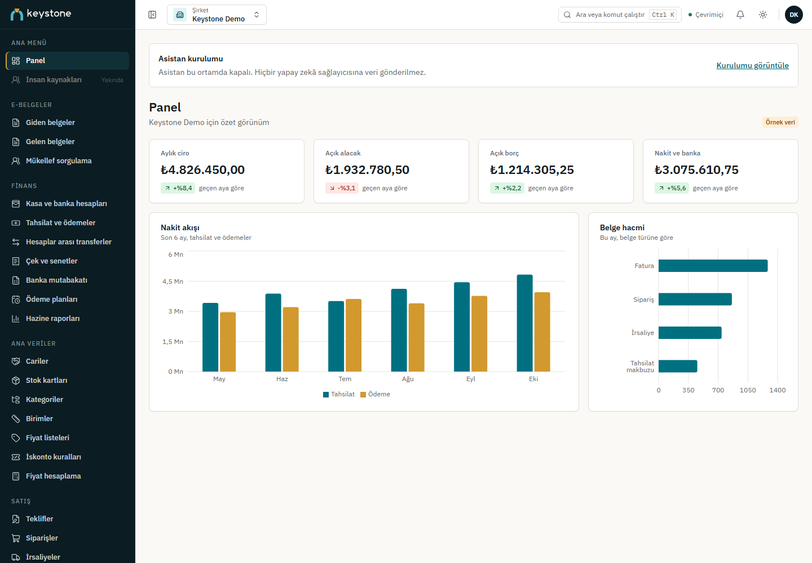
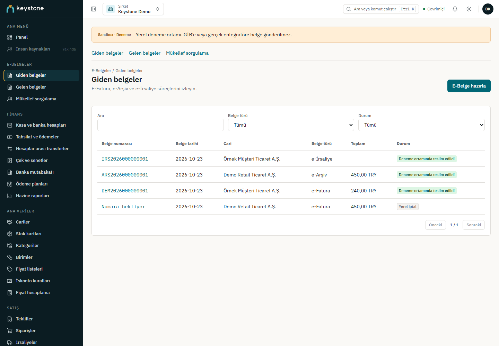
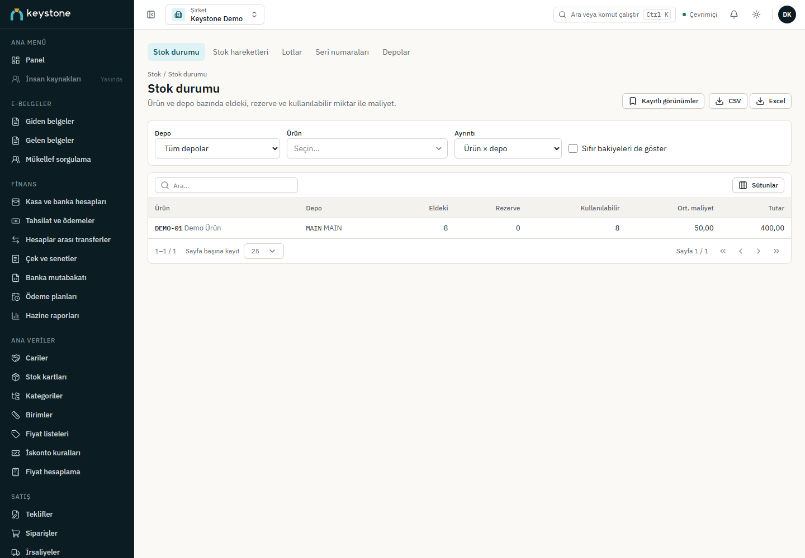

# Keystone ERP

[English](README.md) · [Türkçe](README.tr.md)

Keystone ERP; muhasebe, stok, satış, satın alma ve finans süreçlerini şirket kapsamlı bir çalışma alanında birleştirir. Laravel API ve React web istemcisinden oluşan modüler monolit yapısındadır. Arayüz İngilizce, Türkçe, Almanca ve Fransızca dillerini destekler.

Geliştirme, resmî UBL-TR yapısal doğrulaması ve yerel sandbox içeren Faz 9'a ulaşmıştır. Üretim, İK/bordro ve yol haritasındaki sonraki modüller henüz uygulanmamıştır. Ayrıntılar için [yol haritasına](docs/ROADMAP.md) ve [ilerleme durumuna](docs/PROGRESS.md) bakın.

## Masaüstü uygulaması ilerlemesi

`█████████████░░░░░░░ 64%`

| Faz | Teslimat | Ağırlık | Durum | Faz içi yüzde |
|---|---|---|---|---|
| D0 | Repo ve sözleşmeler | 5 | Tamam | %100 |
| D1 | Sunucu sync modülü (web reposu) | 25 | Tamam | %100 |
| D2 | `keystone-sync` crate | 20 | Tamam | %100 |
| D3 | Tauri kabuğu | 20 | Sürüyor | %70 |
| D4 | Frontend entegrasyonu | 15 | Başlamadı | %0 |
| D5 | OS entegrasyonu | 5 | Başlamadı | %0 |
| D6 | Release ve sertleştirme | 10 | Başlamadı | %0 |

Ağırlıklı fazlar; faz içi yüzde birleştirilmiş iş paketlerine göre hesaplanır (D3: 10 iş paketinden 7'si birleştirildi). Son güncelleme: 2026-10-27. Ayrıntılar: [desktop/PLAN.md](desktop/PLAN.md).

## Ekran görüntüleri

Aşağıdaki ekranlarda sentetik demo verileri kullanılmıştır.


*Çalışma alanının genel görünümü.*


*E-belge çalışma alanı. Durumlar ve mükellef sorguları yerel sandbox sonuçlarıdır; canlı GİB sonuçları değildir.*


*Stok ve depo işlemleri.*

## Uygulanan kapsam

| Faz | Alan | Yetenekler |
|---|---|---|
| 0 | Temel | Monorepo, geliştirme altyapısı, mühendislik kuralları ve CI kontrolleri |
| 1 | Platform | Kimlik, şirketler, roller ve izinler, dosyalar, bildirimler ve onaylar |
| 2 | Ana veriler | Cariler, stok/hizmetler, para birimleri, vergiler, vadeler ve depolar |
| 3 | Muhasebe | Hesap planı, mali dönemler, fişler, mali raporlar ve kapanış |
| 4 | Stok | Hareketler, değerleme, transfer, sayım, rezervasyon, lot ve seri |
| 5 | Satış | Teklif, sipariş, irsaliye, fatura ve iade; stok/muhasebe entegrasyonu |
| 6 | Satın alma | Talep, RFQ, sipariş, mal kabul, fatura, iade ve eşleştirme |
| 7 | Finans | Kasa/banka, tahsilat/ödeme, kapama, transfer, çek/senet ve mutabakat |
| 8 | Asistan | İsteğe bağlı şirket kapsamlı konuşmalar, yetkili araçlar ve onaylı taslaklar |
| 9 | E-belgeler | UBL-TR e-Fatura, e-Arşiv fatura ve e-İrsaliye doğrulaması; sandbox gelen/giden kutusu |

Şirket sınırları, işlem izinleri, iyimser sürüm denetimi ve idempotent istekler iş süreçlerini korur. Muhasebe ve stok kayıtları eklemeli defterler ve açık ters kayıt akışları kullanır. Bu süreçlerin kuralları [mimari](docs/ARCHITECTURE.md) ve [mühendislik kuralları](docs/ENGINEERING-RULES.md) belgelerinde açıklanır.

## Teknolojiler

| Katman | Teknoloji |
|---|---|
| Backend | PHP 8.4, Laravel 13, PostgreSQL 18, Redis 8 |
| Frontend | React 19, TypeScript, Vite; Node.js 22.22+ ve npm |
| Arka plan/gerçek zamanlı | Redis kuyrukları, Laravel Horizon ve Reverb |
| Yerel servisler | Docker Compose, Mailpit ve MinIO |
| E-belge doğrulaması | PHP DOM/libxml, JDK 21, sürümü sabitlenmiş Saxon |

## Yerel kurulum

Gerekli Composer eklentileriyle PHP 8.4, Composer, Node.js 22.22+, Docker Compose ve JDK 21 kurun. Kullanılacak PHP ve Java sürümlerinin `PATH` üzerinde olduğundan emin olun.

Depo kökünde:

```sh
docker compose up -d
composer --working-dir=backend install
npm ci
```

Windows'ta `install` yerine `composer --working-dir=backend install-windows` kullanın; bu komut Horizon'ın Windows'ta bulunmayan `pcntl`/`posix` eklentilerini ele alır.

`backend/.env.example` dosyasını `backend/.env` olarak kopyalayın. Yerel servis ayarlarını gözden geçirin ve ilk yönetici için kendi bilgilerinizi ekleyin:

```dotenv
ADMIN_NAME=Adınız Soyadınız
ADMIN_EMAIL=adresiniz@example.com
ADMIN_PASSWORD=kendi-uzun-parolanizla-degistirin
```

Varsayılan giriş bilgisi yoktur. En az 12 karakterli, adınıza veya e-posta adresinize eşit olmayan bir parola kullanın. Seed işlemi geçerli kimlik bilgileri gerektirir; mevcut yönetici hesabını değiştirmez.

Uygulamayı hazırlayın:

```sh
cd backend
php artisan key:generate
php artisan migrate --seed
php scripts/install-edocument-runtime.php
php scripts/install-edocument-runtime.php --verify-only
cd ..
npm run gen:api
```

Çalışma ortamı kurucusu, özet değerleri sabitlenmiş doğrulama bağımlılıklarını açıkça indirir. Sonrasında belge doğrulaması çevrimdışı çalışır; çalışma ortamı eksikse doğrulama atlanmaz, başarısız olur.

Windows'ta altyapıyı başlatmak ve API, kuyruk, zamanlayıcı, Reverb ve frontend süreçlerini açmak için `dev.bat` çalıştırın. Diğer platformlarda ayrı terminallerde:

```sh
# API, kuyruk dinleyicisi ve Reverb
composer --working-dir=backend dev

# Zamanlayıcı
cd backend
php artisan schedule:work

# Depo kökünden frontend
npm run dev --workspace frontend
```

| Servis | Yerel adres |
|---|---|
| Web istemcisi | http://localhost:5173 |
| API | http://localhost:8000/api/v1 |
| Reverb | http://localhost:8080 |
| PostgreSQL | localhost:5433 |
| Redis | localhost:6379 |
| Mailpit | http://localhost:8025 (SMTP: 1025) |
| MinIO | http://localhost:9001 (API: 9000) |

Compose uygulamayı değil, altyapı servislerini başlatır. PostgreSQL ilk kurulumda `keystone` ve `keystone_test` veritabanlarını oluşturur; `pg_trgm` ve `pgcrypto` eklentilerini açar. Şirkete ait varsayılan referans tanımları şirket oluşturulurken hazırlanır.

## E-belge sınırları

`EDOCUMENTS_DRIVER=sandbox`, yerel giden/gelen kutusu, mükellef dizini ve yanıt akışlarını sağlar. Temel/ticari/ihracat/kamu e-Fatura, e-Arşiv fatura ve temel e-İrsaliye desteklenir. XML, kaynak belgenin tutarlarını korur; depodaki XSD ve şematron kurallarıyla denetlenir.

Bunlar imzasız sandbox belgeleridir. Yapısal doğrulama, dijital imzayı doğrulamaz ve hukuki geçerlilik sağlamaz. Canlı GİB/özel entegratör adaptörü, yasal imzalama akışı veya e-Arşiv rapor paketi gönderimi yoktur. Gelen belgeler otomatik muhasebe kaydı ya da ödeme oluşturmaz. Kurulum, izinler ve desteklenen işlemler için [e-belgeler](docs/EDOCUMENTS.md) belgesine bakın.

## İsteğe bağlı asistan

Asistan varsayılan olarak kapalıdır. Açmak için sağlayıcının API anahtarını sunucuda yapılandırın ve aşağıdaki ayarları yapın:

```dotenv
ASSISTANT_ENABLED=true
ASSISTANT_PROVIDER=openai
ASSISTANT_MODEL=your-provider-model
```

Seçilen model araç kullanımını desteklemelidir. Konuşmalar geçerli kullanıcı ve şirkete aittir. Yetki denetimli 20 araç, okuma işlemleri ve insan onaylı üç taslak türü sunar: muhasebe fişi, satın alma talebi ve satış teklifi. Asistan kesinleştirme, ödeme veya kayıt silme yapamaz. Bütçe ve gizlilik denetimleri [Asistan](docs/ASSISTANT.md) belgesinde açıklanır.

## Doğrulama ve API tipleri

```sh
composer --working-dir=backend lint
composer --working-dir=backend analyse
composer --working-dir=backend test
npm run lint --workspace frontend
npm run typecheck --workspace frontend
npm run test --workspace frontend
npm run i18n:check --workspace frontend
npm run build --workspace frontend
```

Backend özellik testleri test veritabanı ve yerel bağımlılıklar gerektirir. E-belge testleri ayrıca Java doğrulama çalışma ortamını kullanır. Backend test komutu mimari ve uygulama testlerini ayrı çalıştırır.

OpenAPI çıktısı ve frontend API tipleri üretilen dosyalardır; depoda tutulmaz. Bağımlılık kurulumundan ve API değişikliklerinden sonra, frontend tip denetimi veya derlemesinden önce `npm run gen:api` çalıştırın. Başarılı API yanıtları `data`, hatalar `errors` zarfını kullanır.

## Belgeler

- [Mimari](docs/ARCHITECTURE.md) · [Mühendislik kuralları](docs/ENGINEERING-RULES.md) · [Mimari kararlar](docs/adr/)
- [Yol haritası](docs/ROADMAP.md) · [İlerleme](docs/PROGRESS.md)
- [Kimlik doğrulama](docs/AUTH-FLOWS.md) · [Çoklu şirket](docs/MULTI-COMPANY.md) · [Ana veriler](docs/MASTER-DATA.md)
- [Muhasebe](docs/ACCOUNTING-ENGINE.md) · [Stok](docs/INVENTORY-ENGINE.md) · [Satış](docs/SALES-ENGINE.md)
- [Satın alma](docs/PURCHASING-ENGINE.md) · [Finans](docs/TREASURY-ENGINE.md)
- [Asistan](docs/ASSISTANT.md) · [E-belgeler](docs/EDOCUMENTS.md)

## Lisans

Backend paketi proprietary lisans bildirir. Bu depo açık kaynak lisansı vermez.
