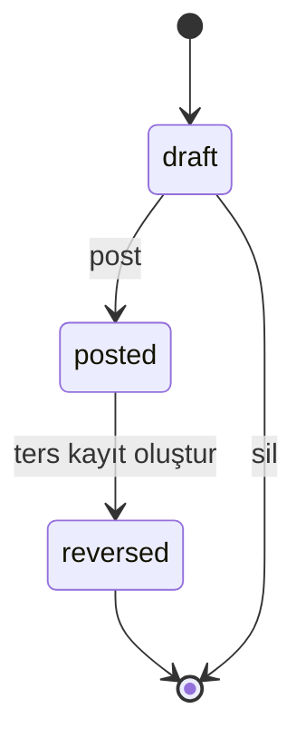
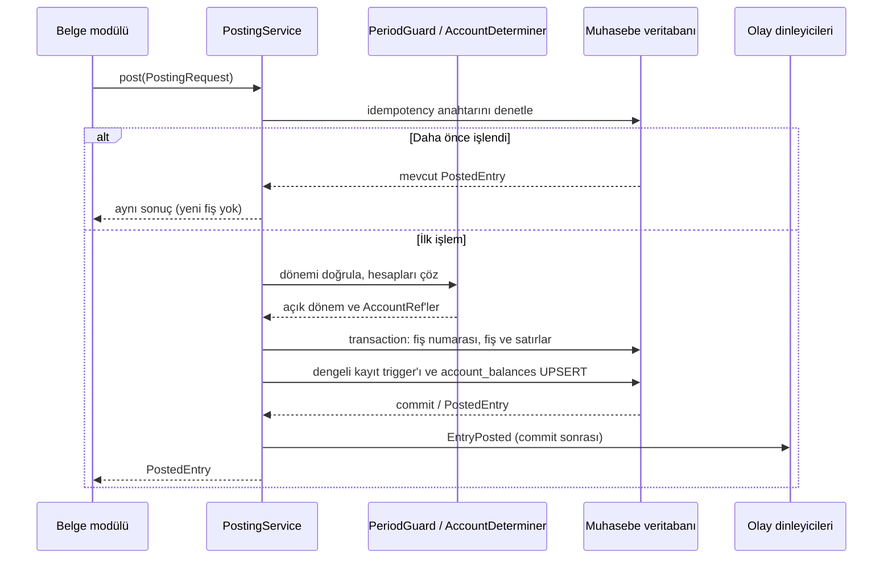

# Faz 3: Genel muhasebe tasarımı

Bu belge, Keystone Faz 3 genel muhasebe sözleşmesini tanımlar. Tutarlar `numeric(20,4)`, kurlar `numeric(20,6)` olarak saklanır; kimlikler UUIDv7, kayıtlar şirket kapsamındadır. API `/api/v1` altındadır ve şirket kapsamlı isteklerde `X-Company-Id` taşınır.

## Mali yıl ve dönemler

- Mali yıl şirket başına `YYYY` koduyla tanımlanır; başlangıç/bitiş tarihleri, `open|closed` durumu, kapatan kullanıcı/zamanı ve sürümü tutulur. Şirket içinde kod benzersizdir; mali yıl tarih aralıkları çakışamaz.
- Yıl oluşturulunca 12 dönem üretilir; isteğe bağlı 13. dönem yıl sonu düzeltmeleri içindir. Dönem numarası 1–13, durum `open|soft_closed|closed` olur. Dönemler yılı boşluksuz ve çakışmasız kaplar; 13. dönem yıl sonunda sıfır uzunluklu olabilir.
- Yıl tarihleri, o yıla ait kayıtlanmış fiş yokken değiştirilebilir. Dönem kapatma, içeride taslak fiş varsa engellenir. Yeniden açma gerekçe ister ve denetlenir.
- Dönemlere kayıt yalnızca `open` iken yapılır. `soft_closed` döneme ancak izin bağlamıyla yazılabilir; kapalı mali yıl her durumda yazmayı engeller. Fiş tarihi kendi dönem aralığında olmalıdır.

## Hesap planı

Hesaplar şirket içinde benzersiz kod taşır; kod en çok 32 karakterdir. Türler: varlık, borç, özkaynak, gelir, gider, maliyet ve nazım. Normal bakiye borç/alacak yönüdür. Hiyerarşide döngü olamaz, üst hesap kayıt kabul edemez; yalnızca yaprak hesaplar kayıtlanabilir. Kullanılmış bir hesabın kayıtlanabilirliği kaldırılamaz ve hesap silinemez.

Hesaplarda aktif/sistem işaretleri, isteğe bağlı TDHP grubu (1–9), yabancı para kodu, cari hesap, masraf merkezi, proje ve kur değerleme gereksinimi ile açıklama/sürüm bulunur. Şirket ayarı `accounting.account_code_prefix_rule` kod önek kuralını isteğe bağlı zorunlu kılabilir. TDHP şablonu ana grupları ve yaygın hesapları sunar; alt hesap açıldığında ana hesabın kayıtlanabilirliği yaprak kuralına göre güncellenir. 7/A veya 7/B seed seçimi `accounting.expense_scheme` ayarına bağlıdır.

## Muhasebe fişi ve yaşam döngüsü

Fiş türleri açılış, genel, tahsilat, ödeme, düzeltme, kur değerleme, kapanış, ters kayıt ve sistemdir. Taslak fiş satırları düzenlenebilir; fiş numarası taslakta boş kalır. Kayıtla (post) numara atanır, bakiyeler güncellenir ve `EntryPosted` olayı işlem tamamlandıktan sonra yayınlanır. Kayıtlı fiş değiştirilemez. Ters kayıt, özgün kaydın borç/alacaklarını aynalayan yeni bir fiş üretir ve iki kaydı karşılıklı bağlar; özgün durum `reversed` olur. Yalnızca taslak silinebilir.

### Veritabanı değişmezleri ve gerekçeleri

1. Ertelenebilir, işlem sonu çalışan constraint trigger, `posted` fişlerde borç toplamının alacak toplamına eşit olmasını doğrular. Kontrolün commit anında yapılması, çok satırlı fişin ara yazımlarında geçici dengesizliğe izin verir; dengesiz fişin kalıcılaşmasını önler.
2. Satır ve fiş üzerindeki UPDATE/DELETE trigger'ları kayıtlı veriyi değişmez kılar. Tek istisna, `posted → reversed` geçişinde yalnızca ters kayıt bağlantısı/durumu ile sürümün güncellenmesidir. Böylece muhasebe izi korunur; düzeltme yeni ters kayıtla yapılır.
3. Kayıt durumuna geçişte trigger dönem kapısını ve mali yıl durumunu denetler; kapalı döneme veya yıla sessizce kayıt düşmesini engeller. İzin bağlamı yoksa `soft_closed` de kapalı sayılır.
4. Kayıt tarihinin döneme ait olması zorunludur; tarihe göre raporlar ve dönem bakiyeleri aynı sınırı kullanır. Kayıtlı satırlarda kullanılan hesap silinemez veya kayıt dışı bırakılamaz; tarihsel raporların anlamı korunur.

## Kayıt servisi ve yineleme güvenliği

Diğer modüller muhasebe tablolarına doğrudan yazmaz; `App\\Modules\\Accounting\\Contracts` içindeki `PostingService` üzerinden kayıt yapar. `post(PostingRequest $r): PostedEntry` isteği şirketi, tarihi, türü, açıklamayı, kaynak türü/kimliğini ve satırları taşır. Satırda `accountId` veya `accountCode`, borç/alacak ve isteğe bağlı para, yabancı para tutarı/kuru, cari, masraf merkezi, proje ve açıklama bulunabilir. İstek DTO'su salt okunurdur.

Aynı `(companyId, sourceType, sourceId, purpose)` anahtarı tekrar işlendiğinde ikinci fiş oluşturulmaz; böylece istemci veya iş tekrarları çift kayıt yaratmaz. HTTP POST işlemleri idempotency anahtarını da kullanır. Servis dönem denetimini, hesap çözümlemeyi, fiş/satır yazımını, gapless numara tahsisini ve `account_balances` güncellemesini tek işlem sınırında yürütür. Fiş numarası `NumberSequenceService` ile yalnızca kayıt anında verilir; belge türü `journal`, mali yıl başına sayaçtır. Olaylar commit sonrasında yayınlanır. Ters kayıt imzası `reverse(string $entryId, DateTimeInterface $date, string $reason): PostedEntry` şeklindedir.

## Hesap belirleme

`AccountDeterminer::resolve(eventKey, context): AccountRef`, şirketin ilgili olay için kayıtlı kurallarını inceler. Eşleşme koşulları cari grubu, ürün kategorisi, para birimi ve vergi kodunu içerebilir. En yüksek öncelikli koşul eşleşmesi seçilir; eşleşen koşul kuralı yoksa varsayılan kural kullanılır. Varsayılan da yoksa `AccountNotDetermined` (HTTP 422) döner; tahmini hesapla kayıt yapılmaz. Kurallar şirket başına varsayılanlarla tohumlanır ve yetkili kullanıcılarca yönetilebilir.

Başlangıç olayları: `sales.receivable`, `sales.revenue.goods`, `sales.revenue.services`, `sales.vat_output`, `sales.returns`; `purchase.payable`, `purchase.expense`, `purchase.vat_input`, `purchase.vat_withholding`; `inventory.stock`, `inventory.cogs`; `treasury.cash`, `treasury.bank`, `treasury.cheque_portfolio`; `fx.gain`, `fx.loss`; ileride `payroll.*`. Kuralları deneme uç noktası hesap çözümünü kayıt yapmadan önizler.

## Yıl sonu kapanışı ve kur değerleme

Mali yıl kapatma, yapılandırılabilir ve Settings içinde belgelenmiş eşlemeye göre kapanış fişleri üretir: 6. grup gelir/gider ve 7. grup maliyet hesaplarını sonuç hesaplarına aktarır; varsayılan TDHP örneği `6xx → 690 Dönem Kârı veya Zararı`, `692 → 590/591` şeklindedir. Yeni yıl için bilanço hesaplarının bakiyelerini taşıyan açılış fişi üretilir. Her iki fiş türü uygun biçimde terslenebilir; yıl kapalıyken bu fişlerin terslenmesi için önce yıl yeniden açılır. İşlem tamamlanınca yıl kapalı işaretlenir.

Kur değerleme, dönem ve kur tarihine göre `is_revaluable` yabancı para hesaplarının gerçekleşmemiş farklarını `ExchangeRateProvider` ile hesaplar. Önizleme (`dry_run`) önce sunulur; onayda `fx.gain`/`fx.loss` belirlemesiyle düzeltme fişi kaydedilir (varsayılan hesaplar 646/656). Sonraki dönemin ilk gününe otomatik ters kayıt planlanır.

## Raporlar ve veri kaynakları

Tüm raporlar `accounting.reports.view` ister; sayılar JSON'da metin, tarih aralıkları kapsayıcıdır. CSV/XLSX dışa aktarımı ortak dışa aktarıcıyla, 50.000 satır sınırı ve CSV formül korumasıyla yapılır.

- **Mizan (trial balance):** dönem veya tarih aralığı, seviye, sıfır bakiyeler, önceki yılla karşılaştırma, kümülatif toplam ve TDHP grubuna göre gruplama; borç/alacak toplamı eşitliğini denetler.
- **Büyük defter:** hesap bazında açılış, hareketler ve yürüyen bakiye; sayfalıdır.
- **Yevmiye defteri:** numaraya göre sıralı fişler, sayfa ve toplamlar arasında devreden/nakledilen tutarlar.
- **Cari hesap ekstresi:** cari boyutlu satırlar; `party_id` ve hesap aralığı ile süzülür.

Dönemlerle hizalı istekler hızlı kaynak olarak `account_balances` tablosunu kullanır. Diğer tarih aralıkları ve satır ayrıntısı gereken raporlar `journal_lines` ile kayıtlı fişlerden hesaplanır. `account_balances`, kayıt transaction'ında UPSERT edilir; `accounting:rebuild-balances` yeniden kurar. Testler dönem bakiyelerini kayıtlı satırların toplamıyla karşılaştırır; iki kaynağın eşitliği doğrulanır.

## İzin adları

İzin biçimi `<kaynak>.<eylem>`; şirket rolleri kapsamında uygulanır. Kullanılan adlar:

- `accounting.periods.view`, `accounting.periods.manage`, `accounting.periods.close`, `accounting.periods.reopen`
- `accounting.year.close`
- `accounting.accounts.view`, `accounting.accounts.manage`
- `accounting.entries.view`, `accounting.entries.create`, `accounting.entries.post`, `accounting.entries.reverse`
- `accounting.determination.manage`, `accounting.reports.view`, `accounting.revaluation.run`

## Yeni bir modül muhasebe kaydı nasıl atar?

- Belgenin kaynak türü/kimliği ve amaç anahtarını belirle; POST tekrarları için idempotency anahtarı gönder.
- Belge tarihini, türünü, açıklamasını ve borç/alacak satırlarını oluştur; tutarlar ondalık metin olarak iletilir.
- Her satırda hesap kimliği/kodu ve gereken cari, masraf merkezi, proje, para/kuru ekle; gerekiyorsa `AccountDeterminer` ile olay ve bağlamdan hesabı çöz.
- `PostingService::post()` çağır; muhasebe tablolarını doğrudan yazma. Kapalı dönem, dengesizlik veya çözülemeyen hesap hatalarını belge akışında göster.
- Dönen `PostedEntry` kimliğini belgeyle ilişkilendir; iptal/düzeltmede kayıtlı fişi değiştirme, `PostingService::reverse()` kullan.
