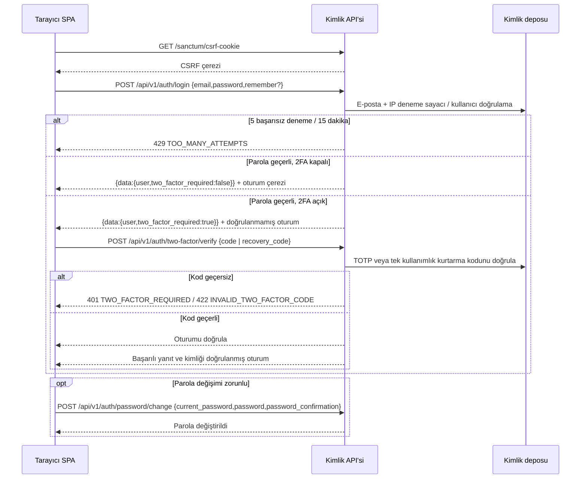

# Kimlik doğrulama akışları — Faz 1

Tüm API yolları `/api/v1` altındadır. Tarayıcı SPA kimlik doğrulaması Sanctum oturum çereziyle yapılır. Başarılı yanıtlar `{data: ...}`; hatalar `{errors:{message,code,fields?}}` biçimindedir.

## SPA oturumu ve parola girişi

1. İstemci `GET /sanctum/csrf-cookie` ile CSRF çerezini alır; oturum açma ve oturum gerektiren isteklerde çerezleri gönderir ve CSRF belirtecini Laravel'in beklediği başlıkta taşır. `419` yanıtında CSRF çerezini yenileyip isteği bir kez tekrarlar.
2. `POST /api/v1/auth/login` gövdesi `{email,password,remember?}` olur. E-posta ve IP çiftinde 15 dakika içinde 5 başarısız deneme `429 TOO_MANY_ATTEMPTS` ile kilitlenir.
3. Başarılı yanıtta kullanıcı ve `two_factor_required` döner. İki faktör kapalıysa oturum doğrulanmış olur; açıksa oturum doğrulanmamış kalır ve korumalı API erişimi açılmaz.
4. `GET /auth/me`, kullanıcıyı, şirketleri, şirket başına rol adlarını ve izinleri; ayrıca `is_super_admin`, `must_change_password` ve `two_factor_enabled` alanlarını verir.
5. `must_change_password` doğruysa normal korumalı işlemler `403 PASSWORD_CHANGE_REQUIRED` ile engellenir. Yalnızca parola değiştirme akışı tamamlandıktan sonra normal uygulama kullanımı sürer.

## Giriş ve iki faktör doğrulaması



## TOTP kurulumu, doğrulama ve kurtarma

- Giriş tamamlandıktan sonra kullanıcı `POST /auth/two-factor/setup` çağırır; `secret`, `otpauth_url` ve `qr_svg` döner. Kullanıcı bunları doğrulama uygulamasına ekler.
- `POST /auth/two-factor/confirm {code}` geçerli TOTP'yi doğrular, 2FA'yı etkinleştirir ve `recovery_codes` listesini yalnızca bu yanıtta sunar. Kodlar güvenli biçimde saklanmalıdır.
- Sonraki girişte `POST /auth/two-factor/verify {code}` TOTP'yi, `{recovery_code}` ise tek kullanımlık kurtarma kodunu kabul eder. Geçersiz kod `422 INVALID_TWO_FACTOR_CODE` olur.
- Devre dışı bırakma `DELETE /auth/two-factor {password}` ile ve parola doğrulamasıyla yapılır.

## Parola, oturum ve cihaz güvenliği

- Zorunlu parola değişimi `POST /auth/password/change {current_password,password,password_confirmation}` ile yapılır.
- Oturumlar `GET /auth/sessions` ile listelenir; `DELETE /auth/sessions/{id}` seçilen oturumu sonlandırır. `POST /auth/logout` mevcut oturumu kapatır.
- Kullanıcı devre dışı bırakıldığında korumalı istekler `403 USER_DEACTIVATED` alır ve kullanıcıya ait etkin oturumlar/cihaz erişimleri iptal edilir. İstemci bu yanıtla yerel oturumu kapatır. Kimlik API'si `user.{id}` özel kanalında oturum/hesap kapatma olayını yayınlayarak açık istemcilere anlık çıkış bildirir.
- Yönetici parola sıfırlaması `POST /users/{id}/password-reset` ile yapılır; kullanıcı sonraki girişinde `must_change_password` üzerinden yeni parola belirlemeye zorlanır.
- Masaüstü istemcisi için `POST /auth/device {email,password,two_factor_code?,device_name,fingerprint}` kısa ömürlü bir Sanctum erişim belirteci (yetenek `desktop`, varsayılan 60 dk, `DEVICE_ACCESS_TTL_MINUTES`) ve dönen bir yenileme belirteci üretir: `{data:{token,expires_at,refresh_token,refresh_expires_at}}`. `expires_at` erişim belirtecinin bitişidir (`GET /me/devices` içindeki `expires_at` da aynı anlamı taşır).
- `POST /auth/device/refresh {refresh_token}` kimliksizdir (erişim belirteci süresi dolmuş olabilir), hız sınırlıdır ve aynı biçimde yeni `token` ile yeni `refresh_token` döner. Yenileme belirteci 30 gün kayan ömürlüdür (`DEVICE_REFRESH_TTL_DAYS`), her kullanımda yenilenir ve veritabanında yalnızca SHA-256 özeti saklanır. Bilinmeyen veya süresi dolmuş belirteç `401 UNAUTHENTICATED` döner.
- Kullanılmış yenileme belirteçleri cihaz yaşadığı sürece saklanır; ne kadar eski olursa olsun tekrar gelen bir kullanılmış belirteç (çalınma işareti) o cihazın erişim belirtecini ve tüm yenileme belirteçlerini iptal eder ve `401 UNAUTHENTICATED` döner. Hiç kullanılmamış ama süresi dolmuş belirteç de `401` döner ve ölü cihaz kaydını siler. Eşzamanlı yenileme desteklenmez; yenileme ve iptal aynı cihaz satırı kilidi altında sıralanır, bu yüzden iptal sonrası yeni erişim belirteci hayatta kalmaz.
- Her yenileme belirteci, verildiği andaki kullanıcı kimlik doğrulama sürümünü (`auth_version`) taşır. Parola değişimi, yönetici parola sıfırlaması ve 2FA etkinleştirme/devre dışı bırakma sürümü artırır; eski sürümdeki tüm yenileme belirteçleri `401` alır ve istemci yeniden giriş yapar (2FA açıksa TOTP zorunludur).
- Parola değişimi cihaz belirteciyle yapılırsa değişikliği yapan cihaz için eski aile iptal edilir ve yanıt `200 {data:{token,expires_at,refresh_token,refresh_expires_at}}` ile yeni bir aile verir; tarayıcı oturumundan yapılan değişiklik `204` kalır.
- Hız sınırı: başarılı yenilemeler cihaz başına dakikada 10 (`429 TOO_MANY_ATTEMPTS`); başarısız yenilemeler IP başına dakikada 30. Aynı NAT arkasındaki çok sayıda cihaz birbirini engellemez.
- Kullanıcının devre dışı bırakılması, parola değişimi (diğer cihazlar), yönetici parola sıfırlaması, hesap silme ve cihaz iptali (`DELETE /me/devices/{id}`, çıkış) yenileme belirteçlerini de siler. Şirket üyeliği kaybedilirse yenileme çalışır ancak şirket kapsamlı uçlar `403` döner.
- `GET /me/devices` kayıtlı cihazları listeler; `DELETE /me/devices/{id}` cihaz belirtecini iptal eder.

```mermaid
sequenceDiagram
    participant App as Masaüstü istemcisi
    participant API as Kimlik API'si
    participant DB as Kimlik deposu
    App->>API: POST /api/v1/auth/device {email,password,two_factor_code?,device_name,fingerprint}
    API->>DB: Kullanıcı, parola ve varsa 2FA kodunu doğrula
    alt Kimlik bilgisi veya 2FA kodu geçersiz
        API-->>App: Auth hatası
    else Geçerli
        API->>DB: Erişim belirteci (ability: desktop) ve yenileme belirteci özeti oluştur
        API-->>App: {data:{token,expires_at,refresh_token,refresh_expires_at}}
        App->>API: API isteği, Bearer belirteci (desktop)
        API-->>App: İzin verilen yanıt
        App->>API: Erişim belirteci dolunca POST /api/v1/auth/device/refresh {refresh_token}
        alt Yenileme belirteci geçerli ve kullanılmamış
            API->>DB: Eski belirteci kullanıldı işaretle, yeni erişim ve yenileme belirteci oluştur
            API-->>App: {data:{token,expires_at,refresh_token,refresh_expires_at}}
        else Bilinmeyen, süresi dolmuş veya daha önce kullanılmış
            API->>DB: Kullanılmışsa cihazın tüm belirteçlerini iptal et
            API-->>App: 401 UNAUTHENTICATED
        end
    end
    opt Hesap devre dışı bırakılır veya cihaz iptal edilir
        API->>DB: Oturum/belirteci iptal et
        API-->>App: Sonraki istek reddedilir; user.{id} üzerinden anlık çıkış olayı
    end
```