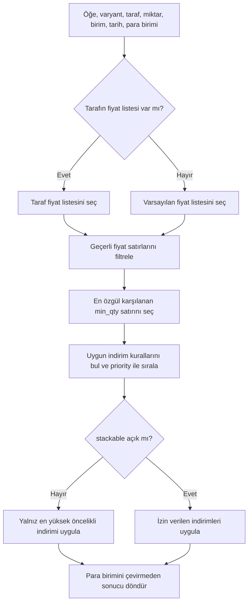

# Ana Veri Tasarımı (Faz 2)

Bu belge Reference, Parties ve Catalog modüllerinin veri ve entegrasyon sözleşmesini tanımlar. Tüm API yolları `/api/v1` altındadır. Şirket kapsamındaki isteklerde `X-Company-Id` gerekir; başarılı yanıtlar `{data, meta?}`, hatalar `{errors}` biçimindedir.

## Ortak kurallar

- Kimlikler UUID; şirket verileri `company_id` ile kapsamlanır. Kodlar şirket başına, silinmemiş kayıtlar arasında benzersizdir. Silme yumuşak silmedir; başka kayıtlarda kullanılan ana veri `is_active=false` yapılır.
- Düzenlenebilir kayıtlarda `version` bulunur; PATCH gövdesi mevcut sürümü taşır. Oluşturan POST uçları idempotency kullanır. Her model değişikliği şirket kapsamlı denetim kaydına yazılır.
- Liste uçları ortak ListQuery sözleşmesini kullanır: `page`, `per_page` (en çok 100), `sort`, `filter[x]`, `q`.
- Para tutarları `numeric(20,4)`, fiyat, kur ve miktarlar `numeric(20,6)`; API'de ondalık değerler string taşınır. Zaman damgaları UTC'dir.
- Modül tablolarına geçiş önekleri Reference `2026_12_01_1xxxxx`, Parties `2026_12_01_2xxxxx`, Catalog `2026_12_01_3xxxxx` biçimindedir. Modüller arası UUID referansları yabancı anahtarsızdır; bütünleşme aşamasında ana sorumlu gerekli FK'leri ekler. Modüller arası varlık denetimi sağlayıcı modülün `Contracts` lookup arayüzünden yapılır.

## Reference

| Kaynak | Model ve kurallar |
|---|---|
| Dövizler | `/currencies`: `code` ISO 4217 üç harf, `name`, `symbol`, `decimals`, `is_active`. Küresel referans satırlarıdır; şirket etkinliği `company_currencies(company_id, currency_code, is_active)` kaydındadır. TRY, USD, EUR, GBP, CHF, JPY ve diğerleri seed edilir. Baz döviz, bu modülün kaydettiği `company.base_currency` ayarıdır; varsayılan TRY. |
| Kurlar | `/exchange-rates`: `currency_code`, `rate_date`, `forex_buying`, `forex_selling`, `banknote_buying`, `banknote_selling` (tümü 20,6), `source` (`tcmb`/`manual`). Benzersizlik: döviz+tarih+kaynak. Son kur `GET /exchange-rates/latest?currency=`, durum `GET /exchange-rates/status`; 4 günden eski veri bayat sayılır. Elle giriş POST'u `exchange_rates.manage` ister. TCMB günlük 16:00 Europe/Istanbul'da çekilir; güncel ve arşiv XML'i, XXE'siz, ağ erişimi kapalı/sınırlandırılmış XML ayrıştırma ve yalnız izinli hosta, yönlendirmesiz, zaman aşımı ve boyut sınırı olan HTTP ile alınır. Tarih parametreli geriye dönük doldurma komutu da vardır. |
| Vergi kodları | `/tax-codes`: `type` vat/withholding/excise/exemption/other, `code`, `name`, `rate` (nullable, 7,4), tevkifat `numerator`/`denominator`, `effective_from`/`effective_to`, `is_active`, `meta`. Doğrulanmış küresel satırlar (company_id yok) ve şirkete özel kodlar (company_id dolu) desteklenir. Seed oranları ve kodları resmi GİB/KDV kaynaklarıyla doğrulanır; kaynak ve erişim tarihi `TAX-ENGINE.md` ile kod yorumlarında yer alır. Doğrulanamayan değer tahmin edilmez, `meta.needs_review` işaretlenir. Güncel KDV oranları 0, 1, 10, 20; tarihçe yalnız doğrulanmış dönemlerle tutulur. |
| Ödeme vadeleri | `/payment-terms`: `code`, `name`, `due_days`, `discount_percent`, `discount_days`, `is_active`. |
| Depolar | `/warehouses`: `code`, `name`, nullable `branch_id`, `address` JSON, `is_active`, `negative_stock_policy` (allow/warn/block), `is_default`. `/warehouses/{id}/locations`: `code`, `name`, nullable `parent_id`, `type` aisle/rack/shelf/bin, `is_active`, `barcode`. |
| Boyutlar | `/cost-centers`: ağaç yapılı `code`, `name`, `parent_id`, `is_active`. `/projects`: `code`, `name`, `status` planned/active/on_hold/closed, `start_date`, `end_date`, nullable `party_id` ve `cost_center_id`. |

Sözleşmeler: `CurrencyLookup::exists(code)`, `TaxCodeLookup::find(id)` (id/koda ve tarihte geçerli orana göre), `PaymentTermLookup::exists`, `WarehouseLookup::exists`, `DimensionLookup`; ayrıca `ExchangeRateProvider::rate(from,to,date): string`. Kur sağlayıcısı TRY üzerinden çapraz kur hesaplar, en fazla 7 gün önceki son veriyi kullanır; yoksa `RateNotFound` fırlatır.

## Parties

`/parties` kaydı: UUID `id`, otomatik `code` (NumberSequence `party`, tek P serisi ve yıl içermeyen 6 hane; ileride yapılandırılabilir), `name`, `legal_name`, `type` company/person, `roles` JSON (customer/supplier alt kümesi, en az biri), `tax_office`, `tax_number`, `country` (ISO 3166-1 alpha-2), `default_currency_code`, nullable `payment_term_id`, `price_list_id`, `risk_limit` (20,4), `risk_currency_code`, `is_active`, `notes`, `tags` JSON, `version`. Şirket içindeki aktif kayıtların vergi numarası tekrarlanamaz. `GET /parties/duplicates?tax_number=&name=` yinelenme araması sağlar.

Türkiye'de şirket için vergi numarası (VKN) 10 rakam ve resmi kontrol basamağı algoritmasıyla; kişi için T.C. kimlik numarası (TCKN) 11 rakam ve kendi kontrol algoritmasıyla doğrulanır. Ülke TR değilse `tax_number` yabancı numara biçiminde serbesttir.

Alt kaynaklar:

- `/parties/{id}/addresses`: `type` billing/shipping/other, `label`, `line1`, `line2`, `district`, `city`, `postal_code`, `country`; her tür için bir varsayılan adres.
- `/parties/{id}/contacts`: `name`, `title`, `email`, `phone`, `is_primary`.
- `/parties/{id}/bank-accounts`: `bank_name`, `iban`, `swift`, `currency_code`, `is_default`. IBAN Türkiye biçimi ve mod-97 kontrolüyle doğrulanır.

Arama `name`, `legal_name`, `code`, `tax_number` alanlarında pg_trgm kullanır. `PartyLookup::find` diğer modüllerin sözleşmesidir. Bakiye ve risk uçları finans kapsamındadır ve bu fazda yoktur.

İzinler: `parties.view`, `parties.create`, `parties.update`, `parties.delete`, `parties.export`; alt kaynaklar `parties.update` iznini kullanır.

## Catalog

| Kaynak | Model ve doğrulama |
|---|---|
| Birimler | `/units`: şirket başına `code`, `name`, `symbol`, `is_active`. `/unit-conversions`: `from_unit_id`, `to_unit_id`, `factor` (20,6). Öğe alternatif birimleri temel birime dönüşümle tanımlar. |
| Kategoriler | `/item-categories`: ağaç `code`, `name`, `parent_id`. |
| Öğeler | `/items`: NumberSequence `item` ile otomatik `code`, `name`, `type` stock/service, `base_unit_id`, nullable `category_id`, `default_tax_code_id` ve `purchase_tax_code_id` (Reference UUID), `tracking` none/lot/serial, `has_expiry`, `min_stock`, `reorder_point`, `is_active`, `attributes` JSON, `version`. |
| Varyantlar ve barkodlar | `/items/{id}/variants`: şirket içinde benzersiz `sku`, `attributes` JSON, `is_active`. `/items/{id}/barcodes`: şirket içinde benzersiz `barcode`, `unit_id`, nullable `variant_id`, `is_primary`. Türü EAN-13, EAN-8 veya UPC olarak belirtilen barkodda ilgili kontrol basamağı doğrulanır. |
| Fiyat listeleri | `/price-lists`: `code`, `name`, `currency_code`, `is_default`, `valid_from`, `valid_to`, `is_active`, `tax_inclusive`. `/price-lists/{id}/lines`: `item_id`, nullable `variant_id`, `unit_id`, `min_qty` (20,6), `price` (20,6), geçerlilik başlangıç/bitiş tarihleri. |
| İndirim kuralları | `/discount-rules`: `code`, `name`, `scope` item/category/party/all, nullable `scope_ref`, `party_id`, `min_qty`, `discount_percent` (7,4), `priority`, geçerlilik tarihleri, `is_active`; `stackable` varsa kuralla açıkça belirtilir. |

Fiyat çözümleme sözleşmesi `PriceResolver::resolve(item, variant?, party?, qty, unit, date, currency)` çıktısı `{unit_price, currency, price_list_id, discount_percent, source}` biçimindedir. Öncelik: tarafın fiyat listesi, sonra varsayılan liste; uygun satırlar arasında en özgül (en yüksek karşılanan `min_qty`), geçerli tarih; ardından uygulanabilir indirimlerde öncelik sırası. İndirimler, kural `stackable` demedikçe üst üste uygulanmaz. Para birimi çevrimi burada yapılmaz. UI için `GET /pricing/resolve` bulunur.

İzinler: `items.view/create/update/delete`, `units.manage`, `item_categories.manage`, `price_lists.*`, `discount_rules.manage`, `pricing.view`.

## Modüller arası lookup sözleşmeleri

- Catalog, Reference için `CurrencyLookup`, `TaxCodeLookup`, `UnitLookup` (Catalog içi) ve fiyat çözümlemede `PriceResolver` kullanır; Parties kaydındaki para/vade/fiyat listesi ve vergi/depo gibi yabancı UUID varlıkları ilgili sağlayıcının lookup arayüzüyle denetlenir.
- Parties, para birimi, ödeme vadesi ve fiyat listesi referanslarını sağlayıcı sözleşmeleriyle kontrol eder. Proje `party_id` ilişkisi Parties `PartyLookup` ile doğrulanır.
- Reference projelerdeki `party_id` değerini `PartyLookup`, depo/birim/vergi/döviz referanslarını kendi sözleşmeleriyle sunar. Modüller başka modülün tablo/modeline doğrudan sorgu atmaz.
- Sağlayıcı modül kurulu değilse (çıplak kurulum) varsayılan `NullLookup` “kullanılamıyor” sonucunu verir; tam kurulumda gerçek arayüzler bağlıdır (bkz. Entegrasyon).

## Entegrasyon

Faz 2 modülleri bütünleşmede birbirine aşağıdaki şekilde bağlandı. Uygulama denetimi (aktif şirkette lookup, başka şirketin kimliği için 422) aynen sürer; veritabanı anahtarları ek güvencedir.

### Yabancı anahtar haritası

| Tablo.sütun | Hedef | ON DELETE |
|---|---|---|
| Reference, Parties ve Catalog'daki tüm `company_id` sütunları (22 tablo; `exchange_rates` ve `tax_codes` için null = global satır) | `companies.id` | RESTRICT |
| `parties.payment_term_id` | `payment_terms.id` | RESTRICT |
| `parties.price_list_id` | `price_lists.id` | RESTRICT |
| `items.default_tax_code_id`, `items.purchase_tax_code_id` | `tax_codes.id` | RESTRICT |
| `projects.party_id` | `parties.id` | RESTRICT |
| `projects.cost_center_id` (modül içi, önceden vardı) | `cost_centers.id` | NO ACTION |
| `warehouses.branch_id` | `branches.id` | RESTRICT |
| `discount_rules.party_id` | `parties.id` | RESTRICT |
| `company_currencies.currency_code`, `exchange_rates.currency_code`, `parties.default_currency_code`, `parties.risk_currency_code`, `party_bank_accounts.currency_code`, `price_lists.currency_code` | `currencies.code` (global) | RESTRICT (güncellemede de) |

- Gerekçe: ana veriler normalde yumuşak silinir; anahtarlar yalnızca kalıcı silme/temizlemede devreye girer. SET NULL bir carinin vadesini ya da kalemin vergi kodunu sessizce değiştirirdi, CASCADE ana veriyi yok ederdi; bu yüzden temizlik bilinçli ve sıralı yapılmalıdır.
- Kapsam dışı: `discount_rules.scope_ref` (kapsama göre kalem, kategori veya cari), dosya/onay çok biçimli kimlikleri.
- Göçler: `app/Modules/Organization/Database/migrations/2026_12_09_200100_*` (company_id) ve `database/migrations/2026_12_09_100100_*` (modüller arası). Kurulu olmayan modülün tabloları atlanır.
- Dolu veritabanı: göçler önce yetim satırları (var olmayan kayda işaret eden referans) tablo.sütun başına sayılarıyla raporlar ve durur; sessiz onarım yoktur. `php artisan master-data:repair-orphans --dry-run` listeyi gösterir; seçeneksiz çalıştırma yalnızca boşaltılabilecek referansları NULL yapar (vade, fiyat listesi, vergi kodları, proje carisi, depo şubesi, varsayılan ve banka hesabı para birimi; `version` artar, etkinlik günlüğüne yazılmaz). `company_id`, zorunlu para birimi kodları, risk para birimi ve cari indirim kuralları elle düzeltilmelidir (komut bu durumda 1 ile çıkar). Anahtarlar `NOT VALID` eklenir ve ayrı adımlarda `VALIDATE CONSTRAINT` ile doğrulanır (göç tek işlemde çalışmaz), böylece yazma kilitleri kısa kalır; yarıda kalan göç tekrar çalıştırılabilir.
- Şirketler arası tutarlılık: tek sütunlu anahtarlar bir kaydın başka şirketin kaydına işaret etmesini engellemez (bileşik kiracı anahtarları şimdilik fazla müdahaleci). Yazmada bunu modül lookup'ları engeller (422). Eski veya doğrudan SQL ile yazılmış veri için salt okunur denetim: `php artisan master-data:audit-tenancy` (bulgu varsa tablo.sütun sayılarını yazar, uyarı günlüğe düşer ve 1 ile çıkar; zamanlayıcıya veya CI'a eklenebilir). Global satırlar (`company_id` boş, örn. tohumlanmış vergi kodları) serbesttir.

### Lookup bağlamaları

- Organization `Contracts\BranchLookup::exists(id)` eklendi (aktif şirketin etkin, silinmemiş şubesi). Reference depolarda `branch_id`, projelerde `party_id` için gerçek `BranchLookup` / `PartyLookup` kullanır; `NullLookup` yalnızca modül yokken (çıplak kurulum) devrededir.
- Parties gerçek `CurrencyLookup`, `PaymentTermLookup`, `PriceListLookup`; Catalog gerçek `TaxCodeLookup`, `CurrencyLookup`, `PartyLookup` ile çalışır. `parties.allow_unverified_references` bayrağı çıplak kurulum için kalır (varsayılan kapalı).
- `GET /pricing/resolve` başka şirketin ya da bilinmeyen bir `party_id` değerini artık 422 ile reddeder.
- Ek dosya: `Party`, `Item`, `PriceList`, `Project`, `Warehouse` Files `Attachable` sözleşmesini uygular. Morph adları: `party`, `item`, `price_list`, `reference_projects`, `reference_warehouses`.

### Şirket açılış varsayılanları

Yeni şirket (`POST /companies`, tek işlemde) `CompanyCreated` olayıyla şunları alır; her modül kendi dinleyicisini kaydeder (Reference `SeedCompanyDefaults`, Catalog `SeedDefaultUnits`):

- Para birimleri: TRY, USD, EUR, GBP `company_currencies` içinde etkin; global satırlar yoksa oluşturulur (ReferenceSeeder gerekmez). Ana para birimi ayarı `company.base_currency` = TRY (kayıt defteri varsayılanı).
- Ödeme vadeleri: `CASH` (Peşin, 0 gün), `NET15`, `NET30`, `NET45`, `NET60`, `NET90` ("N gün vadeli").
- Depo: `MAIN` (Ana depo, varsayılan; şirketin zaten varsayılan deposu varsa varsayılan yapılmaz) ve tek konum `DEFAULT` (Varsayılan konum, bin).
- Masraf merkezi: kök `GENERAL` (Genel).
- Birimler: `PCS` (Adet), `KG`, `G`, `LT`, `M`, `CM`, `M2`, `M3`, `BOX` (Kutu), `PACK` (Paket), `HOUR` (Saat), `DAY` (Gün); dönüşümler KG→G 1000, M→CM 100, DAY→HOUR 24 (BOX/PCS kaleme özgü olduğundan eklenmez).
- Kodlar İngilizce ve sabittir; adlar şirketin `general.default_locale` dilinde (varsayılan tr) lang dosyalarından gelir.
- İdempotent: kodu mevcut (yumuşak silinmiş dahil) kayıt dokunulmadan bırakılır; olay tekrarlansa da çoğaltma ya da sıfırlama olmaz. Dinleyicilerden biri hata verirse şirket de oluşmaz. Açılış şirket başına danışma kilidiyle (Reference ve Catalog API yazmalarıyla aynı kilit) sıralanır; eklemeler çakışmaya dayanıklıdır (global para birimleri `ON CONFLICT DO NOTHING`, diğerleri `createOrFirst`). ReferenceSeeder yumuşak silinmiş tohum satırlarını geri getirmez.
- `CompanyCreated(seedDefaults: false)` varsayılanları atlar (içe aktarma, test fikstürleri; `Identity::company()` testlerde varsayılan olarak boş şirket kurar, `defaults: true` ile gerçek akış).

### Tohumlar ve zamanlama

- `DatabaseSeeder` sırasıyla `IdentitySeeder`, `ReferenceSeeder`, `SuperAdminSeeder` çalıştırır; hepsi tekrar çalıştırılabilir (ReferenceSeeder yalnızca eksik global para birimi ve vergi kodlarını ekler, var olanları değiştirmez). Geliştirme ortamında: `ADMIN_EMAIL=... ADMIN_PASSWORD=... php artisan db:seed` (yalnızca kendi geliştirme veritabanınızda).
- TCMB kurları her gün 16:00 (Europe/Istanbul) `rates:fetch-tcmb` ile çekilir (Reference sağlayıcısı kaydeder; `withoutOverlapping`, `onOneServer`). Denetim: `php artisan schedule:list --timezone=Europe/Istanbul` çıktısında `0 16 * * *  php artisan rates:fetch-tcmb` satırı görünmelidir.

### Liste ve belge ekleri

- `GET /exchange-rates`: `filter[date_from]`, `filter[date_to]` (dahil; şirketin manuel kurları + global TCMB) ve mevcut `filter[rate_date]`.
- `GET /currencies`: `filter[company_active]=1|0`; şirket etkinliği satırla birlikte tek sorguda seçilir (satır başına sorgu yok).
- `GET /logs/audit`: her kayıtta `causer: {id, name}` (e-posta yok; silinmiş kullanıcının adı korunur).
- OpenAPI: Parties, Catalog ve Reference için POST ve PATCH gövdeleri ayrı belgelenir; `version` yalnızca PATCH'te zorunludur.

## Çevrimdışı ve masaüstü notları

Masaüstü istemci daha sonra yalnız okuma için yerel kopya tutar: Reference dövizler, şirket döviz etkinlikleri, vergi kodları, ödeme vadeleri, depolar ve konumları, masraf merkezleri ve projeler; Parties taraflar, adresler ve kişiler; Catalog birimler/dönüşümler, kategoriler, öğeler, varyantlar ve barkodlar. Kopyalar sunucudaki değişikliklerle eşitlenir; masaüstü kaynak kayıtları çevrimdışı değiştirmez. Kurlar ve fiyat/indirim çözümleme canlı sunucu verisi gerektirir; çevrimdışı fiyat garantisi verilmez. Bu fazda masaüstü senkronizasyonu uygulanmaz.

## Yeni ana veri kaynağı ekleme kontrol listesi

- [ ] Kaynağın sahibi modülü, alanları, UUID kimliğini, şirket kapsamını ve silme/etkinlik davranışını tanımla.
- [ ] Kod, kapsamlı benzersizlik, doğrulama, sürüm ve denetim kurallarını belirle; gerekli seed değerlerinin kaynaklarını doğrula.
- [ ] Başka modüle referans varsa sağlayıcı `Contracts/*Lookup` sözleşmesini kullan; modüller arası FK veya doğrudan tablo erişimi ekleme.
- [ ] API listesini ListQuery ve ortak yanıt/hata biçimine uydur; yazma POST'larında idempotency ve uygun izin adlarını tanımla.
- [ ] Birim, para, tarih, çevrimdışı/masaüstü kopya ve arama gereksinimlerini belgeleyip istemci sözleşmesini güncelle.
